# Xcasca Color Scheme Gallery

Free **terminal color schemes** (themes) for [Xcasca](https://www.xcasca.com), the SSH terminal for desktop and mobile. Preview each one in the online gallery, download the `.xccolorscheme` file, and import it in a few clicks.

  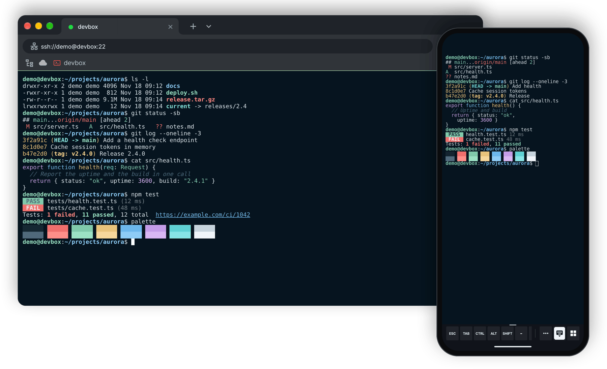

  <a href="https://jooy2.github.io/xcasca-color-scheme/"><strong>Open the gallery</strong></a>
  &nbsp;·&nbsp;
  <a href="#apply-a-scheme">Apply a scheme</a>
  &nbsp;·&nbsp;
  <a href="CONTRIBUTING.md">Add a scheme</a>

An unofficial project, unrelated to the company behind Xcasca.

## What you get

Terminal color schemes as `.xccolorscheme` files, which Xcasca 1.1.2 or later imports on macOS, Windows, Linux, Android and iOS, in three groups:

- **Built into Xcasca**: the ones the app ships with, for anyone who changed them and wants the originals back.
- **Community favorites**: well-known schemes such as Dracula, Nord, Gruvbox and Catppuccin, under their original names. Each keeps its author's license, listed in [CREDITS.md](CREDITS.md).
- **Originals**: made for this collection.

Every file was exported from the app itself, and every pull request is checked against the format the app writes, so a file imports as it is.

## Preview

The [gallery](https://jooy2.github.io/xcasca-color-scheme/) draws each scheme on the same sample sessions: a shell with a file listing, `git status` and `git log`, a code diff with syntax colors, a color test of every style and color pair, and text in Korean, Japanese and Chinese. Switch between schemes to compare them line by line, type in the terminal, filter by dark or light, and download the one you like.

To make a scheme of your own, open the [editor](https://jooy2.github.io/xcasca-color-scheme/editor/): start from any scheme here or from a file you have, change the colors on the same live terminal, and download a `.xccolorscheme` file in the exact layout Xcasca exports.

The gallery reads in [English](https://jooy2.github.io/xcasca-color-scheme/), [한국어](https://jooy2.github.io/xcasca-color-scheme/ko/), [日本語](https://jooy2.github.io/xcasca-color-scheme/ja/), [简体中文](https://jooy2.github.io/xcasca-color-scheme/zh-hans/), [繁體中文](https://jooy2.github.io/xcasca-color-scheme/zh-hant/), [Español](https://jooy2.github.io/xcasca-color-scheme/es/), [Deutsch](https://jooy2.github.io/xcasca-color-scheme/de/) and [Français](https://jooy2.github.io/xcasca-color-scheme/fr/).

## Download

- **One scheme:** the **Download** button in the gallery, or open the file under [`schemes/terminal/`](schemes/terminal/) and choose **Download raw file**.
- **All of them:** **Code** > **Download ZIP** at the top of this page. The schemes are in `schemes/terminal/`.
- **For another terminal app:** **For other apps**, beside **Download** in the gallery and in the editor, writes the same colors for Xshell, Windows Terminal, iTerm2, Ghostty, Alacritty, Kitty or WezTerm. The selection becomes a solid color, and the search highlight colors, which only Xcasca has, are left out.

## Apply a scheme

Import the file once, then choose it for any session. An imported scheme is kept with the ones you make yourself, and syncs to your other devices if you use sync.

### Desktop

The same steps work on macOS, Windows and Linux.

1. Open the **&#8942;** menu at the top right, then **Tools** > **Terminal Color Schemes...**

   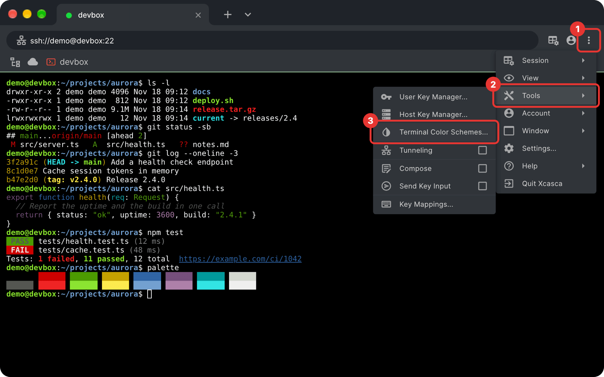

2. Click **&#8942;** under the list, choose **Import...**, and pick the file you downloaded.

   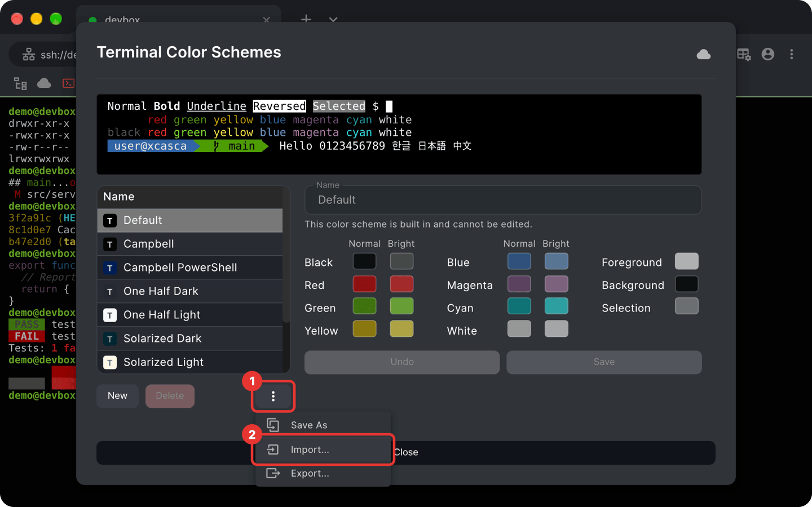

3. The scheme joins the list. Click **Close**.

   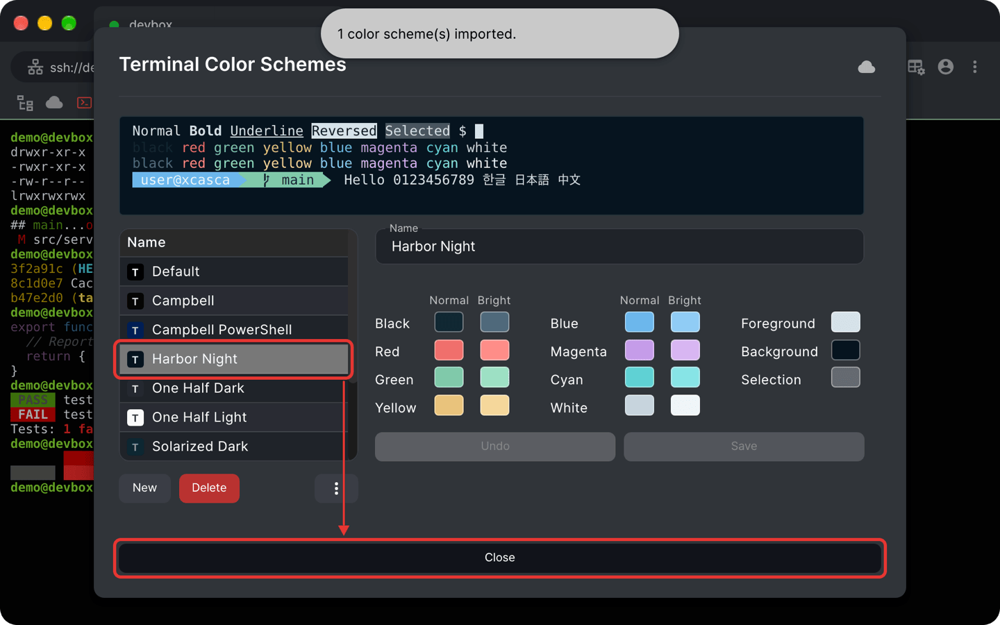

4. Click the session properties button on the toolbar, then **Current Session**. To use the scheme for every new session instead, choose **Default Session**.

   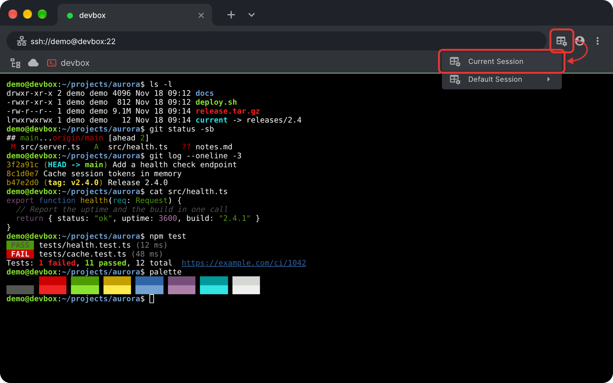

5. Under **Appearance**, choose the scheme in **Color Scheme** and click **OK**.

   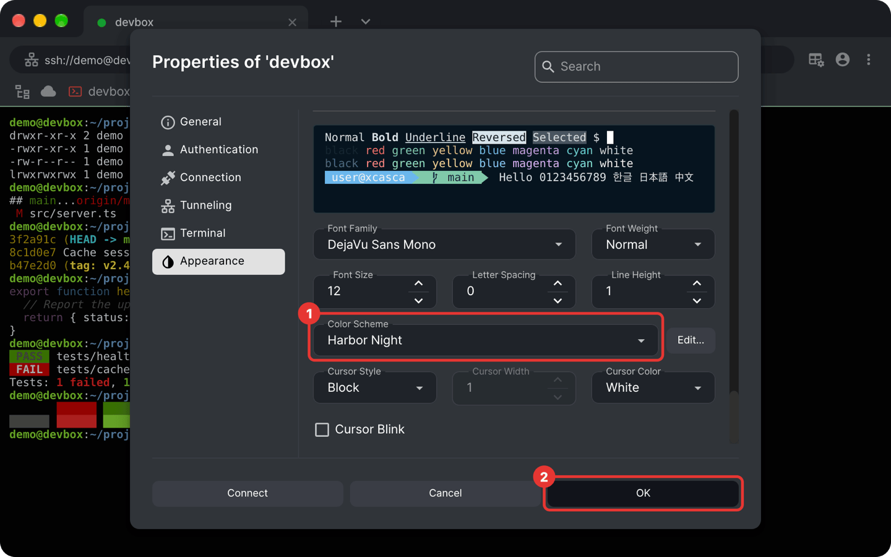

6. The terminal takes the new colors right away.

   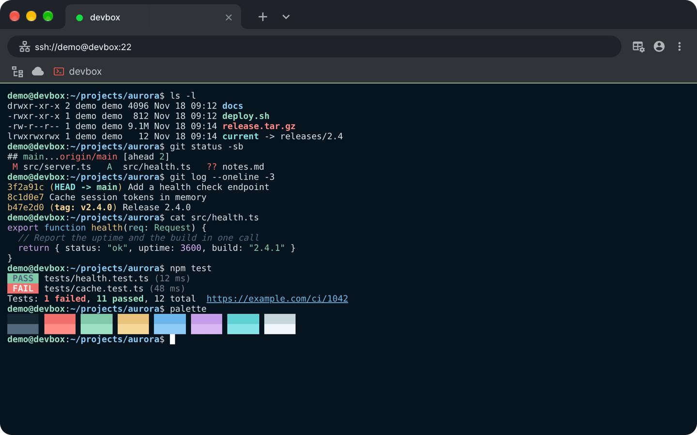

### Android

The iPhone app follows the same steps.

| 1. Open the menu at the bottom left of the home screen and tap **Terminal Color Schemes**. | 2. Tap **+**, then **Import**, and pick the downloaded file. | 3. The scheme joins the list. |
|---|---|---|
| 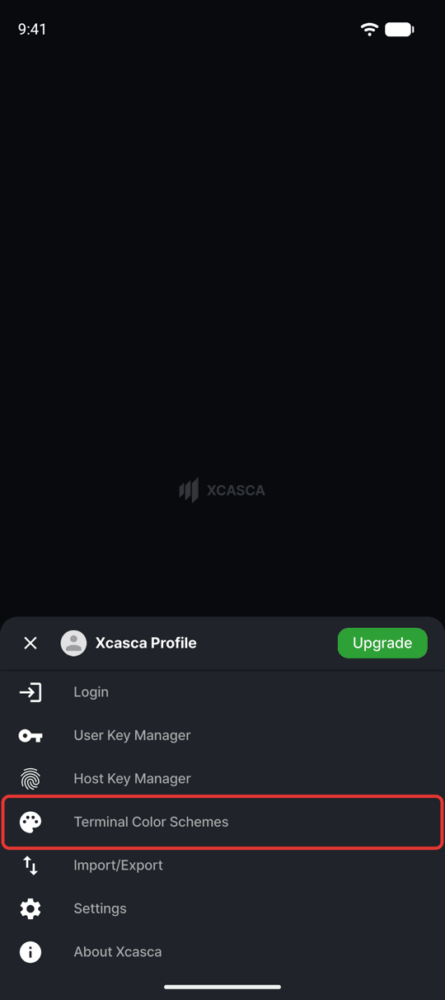 | 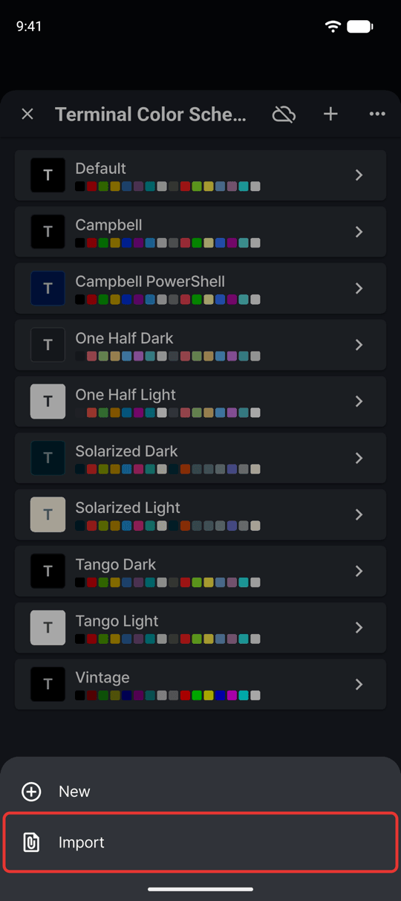 | 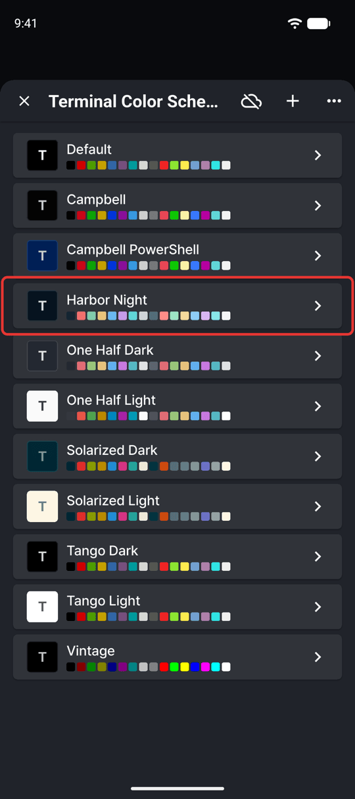 |
| **4.** In **Sessions**, press and hold a session, then tap **Edit**. | **5.** Under **Appearance**, pick the scheme in **Color Scheme**, then tap the check mark to save. | **6.** Open the session to see the new colors. |
| 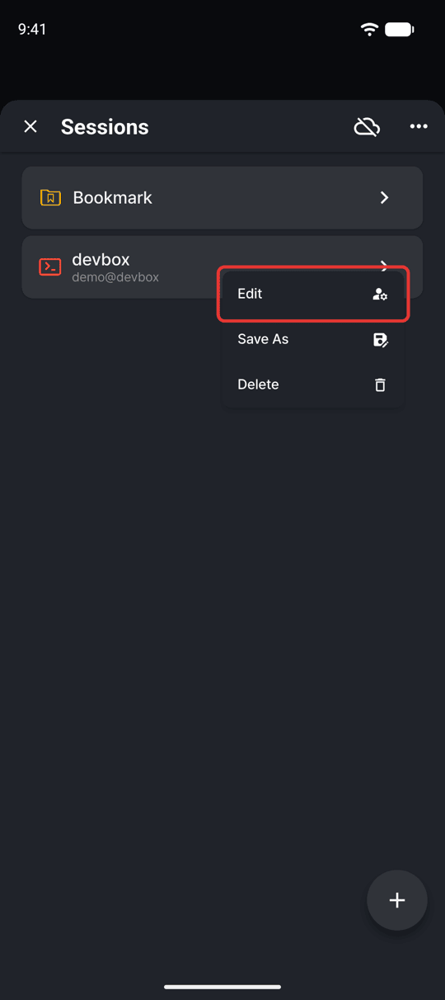 | 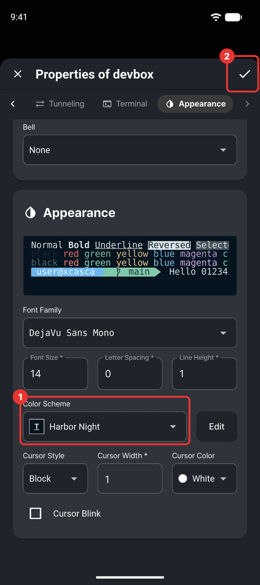 | 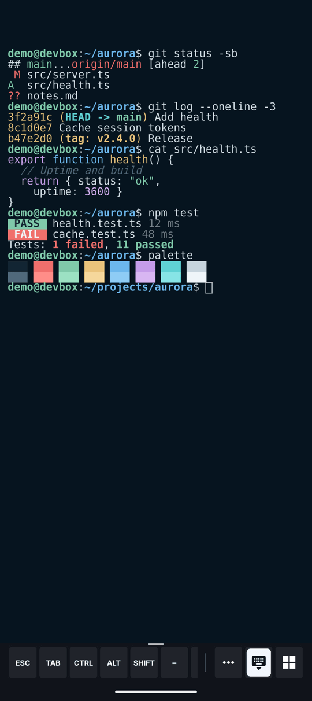 |

If a scheme with the same name is already in the app, the imported one gets a number, such as `Dracula (1)`.

## The schemes

<!-- catalog:start -->

### Built into Xcasca

The schemes the app ships with, as the app exports them.

| Preview | Scheme | Mode | Made by | License |
|---|---|---|---|---|
|  | [Campbell](schemes/terminal/Campbell.xccolorscheme) | Dark | [Microsoft (Windows Terminal)](https://github.com/microsoft/terminal) | MIT |
|  | [Campbell PowerShell](schemes/terminal/Campbell%20PowerShell.xccolorscheme) | Dark | [Microsoft (Windows Terminal)](https://github.com/microsoft/terminal) | MIT |
|  | [Default](schemes/terminal/Default.xccolorscheme) | Dark | [Tango Desktop Project](https://en.wikipedia.org/wiki/Tango_Desktop_Project) | Public domain |
|  | [One Half Dark](schemes/terminal/One%20Half%20Dark.xccolorscheme) | Dark | [Son A. Pham](https://github.com/sonph/onehalf) | MIT |
|  | [One Half Light](schemes/terminal/One%20Half%20Light.xccolorscheme) | Light | [Son A. Pham](https://github.com/sonph/onehalf) | MIT |
|  | [Solarized Dark](schemes/terminal/Solarized%20Dark.xccolorscheme) | Dark | [Ethan Schoonover](https://github.com/altercation/solarized) | MIT |
|  | [Solarized Light](schemes/terminal/Solarized%20Light.xccolorscheme) | Light | [Ethan Schoonover](https://github.com/altercation/solarized) | MIT |
|  | [Tango Dark](schemes/terminal/Tango%20Dark.xccolorscheme) | Dark | [Tango Desktop Project](https://en.wikipedia.org/wiki/Tango_Desktop_Project) | Public domain |
|  | [Tango Light](schemes/terminal/Tango%20Light.xccolorscheme) | Light | [Tango Desktop Project](https://en.wikipedia.org/wiki/Tango_Desktop_Project) | Public domain |
|  | [Vintage](schemes/terminal/Vintage.xccolorscheme) | Dark | [Microsoft (Windows Terminal)](https://github.com/microsoft/terminal) | MIT |

### Community favorites

Well-known schemes, under their original names and licenses.

| Preview | Scheme | Mode | Made by | License |
|---|---|---|---|---|
|  | [Atom One Light](schemes/terminal/Atom%20One%20Light.xccolorscheme) | Light | [GitHub (Atom)](https://github.com/atom/atom) | MIT |
|  | [Ayu Mirage](schemes/terminal/Ayu%20Mirage.xccolorscheme) | Dark | [ayu-theme](https://github.com/ayu-theme/ayu-colors) | MIT |
|  | [Carbonfox](schemes/terminal/Carbonfox.xccolorscheme) | Dark | [EdenEast](https://github.com/EdenEast/nightfox.nvim) | MIT |
|  | [Catppuccin Frappe](schemes/terminal/Catppuccin%20Frappe.xccolorscheme) | Dark | [Catppuccin](https://github.com/catppuccin/catppuccin) | MIT |
|  | [Catppuccin Latte](schemes/terminal/Catppuccin%20Latte.xccolorscheme) | Light | [Catppuccin](https://github.com/catppuccin/catppuccin) | MIT |
|  | [Catppuccin Macchiato](schemes/terminal/Catppuccin%20Macchiato.xccolorscheme) | Dark | [Catppuccin](https://github.com/catppuccin/catppuccin) | MIT |
|  | [Catppuccin Mocha](schemes/terminal/Catppuccin%20Mocha.xccolorscheme) | Dark | [Catppuccin](https://github.com/catppuccin/catppuccin) | MIT |
|  | [Dayfox](schemes/terminal/Dayfox.xccolorscheme) | Light | [EdenEast](https://github.com/EdenEast/nightfox.nvim) | MIT |
|  | [Dracula](schemes/terminal/Dracula.xccolorscheme) | Dark | [Zeno Rocha and the Dracula contributors](https://github.com/dracula/dracula-theme) | MIT |
|  | [Everforest Dark](schemes/terminal/Everforest%20Dark.xccolorscheme) | Dark | [sainnhe](https://github.com/sainnhe/everforest) | MIT |
|  | [Everforest Light](schemes/terminal/Everforest%20Light.xccolorscheme) | Light | [sainnhe](https://github.com/sainnhe/everforest) | MIT |
|  | [Flexoki Dark](schemes/terminal/Flexoki%20Dark.xccolorscheme) | Dark | [Steph Ango](https://github.com/kepano/flexoki) | MIT |
|  | [Flexoki Light](schemes/terminal/Flexoki%20Light.xccolorscheme) | Light | [Steph Ango](https://github.com/kepano/flexoki) | MIT |
|  | [GitHub Dark Default](schemes/terminal/GitHub%20Dark%20Default.xccolorscheme) | Dark | [GitHub (Primer)](https://github.com/primer/github-vscode-theme) | MIT |
|  | [GitHub Dark Dimmed](schemes/terminal/GitHub%20Dark%20Dimmed.xccolorscheme) | Dark | [GitHub (Primer)](https://github.com/primer/github-vscode-theme) | MIT |
|  | [GitHub Light Default](schemes/terminal/GitHub%20Light%20Default.xccolorscheme) | Light | [GitHub (Primer)](https://github.com/primer/github-vscode-theme) | MIT |
|  | [Gruvbox Dark](schemes/terminal/Gruvbox%20Dark.xccolorscheme) | Dark | [Pavel Pertsev](https://github.com/morhetz/gruvbox) | MIT |
|  | [Gruvbox Light](schemes/terminal/Gruvbox%20Light.xccolorscheme) | Light | [Pavel Pertsev](https://github.com/morhetz/gruvbox) | MIT |
|  | [Gruvbox Material Dark](schemes/terminal/Gruvbox%20Material%20Dark.xccolorscheme) | Dark | [sainnhe](https://github.com/sainnhe/gruvbox-material) | MIT |
|  | [Gruvbox Material Light](schemes/terminal/Gruvbox%20Material%20Light.xccolorscheme) | Light | [sainnhe](https://github.com/sainnhe/gruvbox-material) | MIT |
|  | [Iceberg Dark](schemes/terminal/Iceberg%20Dark.xccolorscheme) | Dark | [cocopon](https://github.com/cocopon/iceberg.vim) | MIT |
|  | [Iceberg Light](schemes/terminal/Iceberg%20Light.xccolorscheme) | Light | [cocopon](https://github.com/cocopon/iceberg.vim) | MIT |
|  | [Kanagawa Dragon](schemes/terminal/Kanagawa%20Dragon.xccolorscheme) | Dark | [rebelot](https://github.com/rebelot/kanagawa.nvim) | MIT |
|  | [Kanagawa Wave](schemes/terminal/Kanagawa%20Wave.xccolorscheme) | Dark | [rebelot](https://github.com/rebelot/kanagawa.nvim) | MIT |
|  | [Night Owl](schemes/terminal/Night%20Owl.xccolorscheme) | Dark | [Sarah Drasner](https://github.com/sdras/night-owl-vscode-theme) | MIT |
|  | [Nightfox](schemes/terminal/Nightfox.xccolorscheme) | Dark | [EdenEast](https://github.com/EdenEast/nightfox.nvim) | MIT |
|  | [Nord](schemes/terminal/Nord.xccolorscheme) | Dark | [Sven Greb (Nord)](https://github.com/nordtheme/nord) | MIT |
|  | [Rose Pine](schemes/terminal/Rose%20Pine.xccolorscheme) | Dark | [Rose Pine](https://github.com/rose-pine/rose-pine-theme) | MIT |
|  | [Rose Pine Dawn](schemes/terminal/Rose%20Pine%20Dawn.xccolorscheme) | Light | [Rose Pine](https://github.com/rose-pine/rose-pine-theme) | MIT |
|  | [Rose Pine Moon](schemes/terminal/Rose%20Pine%20Moon.xccolorscheme) | Dark | [Rose Pine](https://github.com/rose-pine/rose-pine-theme) | MIT |
|  | [Selenized Dark](schemes/terminal/Selenized%20Dark.xccolorscheme) | Dark | [Jan Warchol](https://github.com/jan-warchol/selenized) | MIT |
|  | [Selenized Light](schemes/terminal/Selenized%20Light.xccolorscheme) | Light | [Jan Warchol](https://github.com/jan-warchol/selenized) | MIT |
|  | [Seoulbones Light](schemes/terminal/Seoulbones%20Light.xccolorscheme) | Light | [Michael Chris Lopez (Zenbones)](https://github.com/zenbones-theme/zenbones.nvim) | MIT |
|  | [Snazzy](schemes/terminal/Snazzy.xccolorscheme) | Dark | [Sindre Sorhus](https://github.com/sindresorhus/hyper-snazzy) | MIT |
|  | [Sonokai](schemes/terminal/Sonokai.xccolorscheme) | Dark | [sainnhe](https://github.com/sainnhe/sonokai) | MIT |
|  | [Tokyo Night](schemes/terminal/Tokyo%20Night.xccolorscheme) | Dark | [Folke Lemaitre](https://github.com/folke/tokyonight.nvim) | Apache-2.0 |
|  | [Tokyo Night Day](schemes/terminal/Tokyo%20Night%20Day.xccolorscheme) | Light | [Folke Lemaitre](https://github.com/folke/tokyonight.nvim) | Apache-2.0 |
|  | [Tokyo Night Storm](schemes/terminal/Tokyo%20Night%20Storm.xccolorscheme) | Dark | [Folke Lemaitre](https://github.com/folke/tokyonight.nvim) | Apache-2.0 |
|  | [Tomorrow](schemes/terminal/Tomorrow.xccolorscheme) | Light | [Chris Kempson](https://github.com/chriskempson/tomorrow-theme) | MIT |
|  | [Tomorrow Night](schemes/terminal/Tomorrow%20Night.xccolorscheme) | Dark | [Chris Kempson](https://github.com/chriskempson/tomorrow-theme) | MIT |
|  | [Tomorrow Night Eighties](schemes/terminal/Tomorrow%20Night%20Eighties.xccolorscheme) | Dark | [Chris Kempson](https://github.com/chriskempson/tomorrow-theme) | MIT |

### Originals

Made for this collection.

| Preview | Scheme | Mode | Made by | License |
|---|---|---|---|---|
|  | [Dancheong](schemes/terminal/Dancheong.xccolorscheme) | Dark | [jooy2](https://github.com/jooy2) | MIT |
|  | [Ember Glow](schemes/terminal/Ember%20Glow.xccolorscheme) | Dark | [jooy2](https://github.com/jooy2) | MIT |
|  | [Graphite](schemes/terminal/Graphite.xccolorscheme) | Dark | [jooy2](https://github.com/jooy2) | MIT |
|  | [Harbor Night](schemes/terminal/Harbor%20Night.xccolorscheme) | Dark | [jooy2](https://github.com/jooy2) | MIT |
|  | [Lapis](schemes/terminal/Lapis.xccolorscheme) | Dark | [jooy2](https://github.com/jooy2) | MIT |
|  | [Midnight Plum](schemes/terminal/Midnight%20Plum.xccolorscheme) | Dark | [jooy2](https://github.com/jooy2) | MIT |
|  | [Monsoon](schemes/terminal/Monsoon.xccolorscheme) | Dark | [jooy2](https://github.com/jooy2) | MIT |
|  | [Morning Fog](schemes/terminal/Morning%20Fog.xccolorscheme) | Light | [jooy2](https://github.com/jooy2) | MIT |
|  | [Moss Garden](schemes/terminal/Moss%20Garden.xccolorscheme) | Dark | [jooy2](https://github.com/jooy2) | MIT |
|  | [Neon Drift](schemes/terminal/Neon%20Drift.xccolorscheme) | Dark | [jooy2](https://github.com/jooy2) | MIT |
|  | [Paper Ink](schemes/terminal/Paper%20Ink.xccolorscheme) | Light | [jooy2](https://github.com/jooy2) | MIT |
|  | [Sandstone](schemes/terminal/Sandstone.xccolorscheme) | Light | [jooy2](https://github.com/jooy2) | MIT |
|  | [Velvet Dusk](schemes/terminal/Velvet%20Dusk.xccolorscheme) | Dark | [jooy2](https://github.com/jooy2) | MIT |

<!-- catalog:end -->

## Contributing

New schemes, fixes and gallery improvements are welcome. [CONTRIBUTING.md](CONTRIBUTING.md) explains how to make a scheme in the app, export it, and open a pull request. Everyone taking part follows the [Code of Conduct](CODE_OF_CONDUCT.md).

## Working on this repository

The scripts need Node.js 20 or later and nothing else; there are no dependencies to install.

| Command | What it does |
|---|---|
| `npm run validate` | Checks every scheme file and `credits.json`, the same check a pull request runs. |
| `npm run catalog` | Updates the scheme list in this README and the preview images in `docs/swatches/`. |
| `npm run format` | Rewrites hand-edited scheme files in the layout the app exports. |
| `npm run preview` | Builds the gallery into `_site/` and serves it at http://localhost:4173. |
| `npm run build` | Builds the gallery into `_site/`, as the deployment does, along with `llms.txt`, `sitemap.xml` and a 404 page. |
| `npm run sample` | Regenerates the sample sessions the gallery draws, in `site/samples/`. |

Pushing to `main` deploys the gallery to GitHub Pages.

## License

The code, the documentation and the original schemes are released under the [MIT License](LICENSE). The built-in and community schemes keep the licenses of their authors, listed in [CREDITS.md](CREDITS.md). The screenshots show the Xcasca app and are here to document how to use these files with it.
